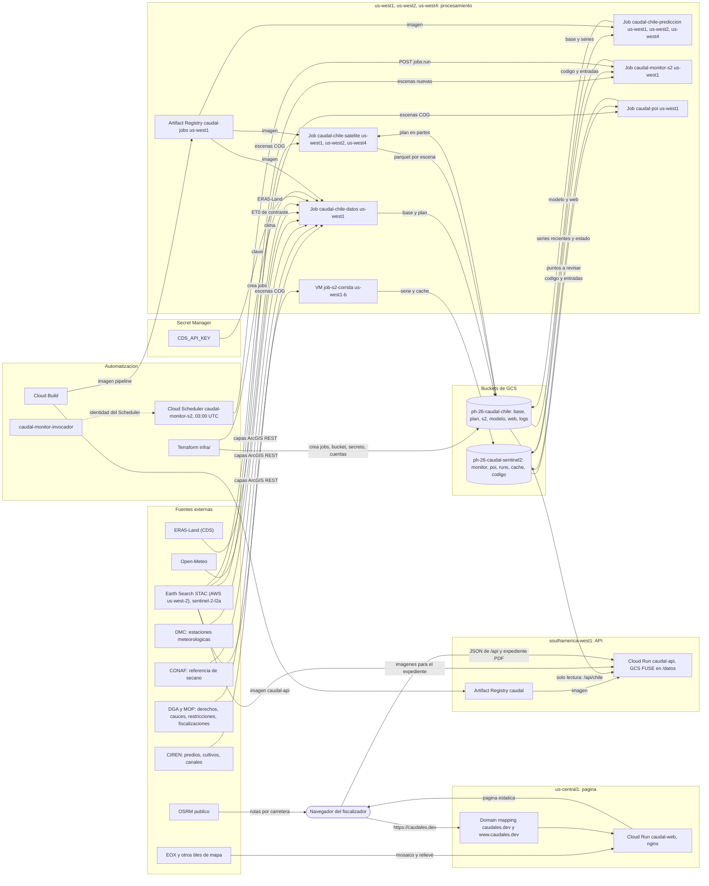

# Arquitectura en GCP

Proyecto GCP `ph-26-caudal`. Caudal corre en Cloud Run y Compute Engine, con dos buckets privados como almacén. Una cadena de jobs por lotes baja imágenes Sentinel-2 y datos públicos de Chile, calcula el índice de sospecha y deja los resultados en `gs://ph-26-caudal-chile`. Un monitor diario extiende las series con las escenas nuevas en `gs://ph-26-caudal-sentinel2`. La página (`caudal-web`) es estática; la API (`caudal-api`) responde las consultas y arma el expediente PDF. Qué se calcula en vivo y qué viene calculado está en [en-vivo-y-precalculado.md](en-vivo-y-precalculado.md).

## Diagrama

Los recursos de `southamerica-west1` y los de `us-west*` están separados a propósito: los jobs corren en Oregón, cerca del bucket de Earth Search en AWS `us-west2`; la API corre en Santiago, cerca de quien la usa. La página pública corre en `us-central1`, donde está el domain mapping de `caudales.dev` (Cloud Run solo admite domain mappings en algunas regiones, y `southamerica-west1` no es una de ellas); el navegador llama directo a la API de Santiago.

## Componentes

| Recurso | Tipo | Región | Qué hace | Dónde se define o despliega |
| --- | --- | --- | --- | --- |
| `caudal-chile-datos` | Cloud Run Job (4 vCPU, 8 GiB, 6 h) | us-west1 | Etapas `base` (14 tareas, una por región) y `plan` (1 tarea): descarga capas de CIREN, DGA, CONAF y clima, y reparte las escenas en partes | [infra/modulos/jobs](../infra/modulos/jobs/main.tf), código en [scripts/cloud/chile/](../scripts/cloud/chile/README.md) |
| `caudal-chile-satelite` | Cloud Run Job (2 vCPU, 4 GiB, 6 h), uno por región | us-west1, us-west2, us-west4 | Etapa `satelite`: una serie Sentinel-2 por escena, en parquet. El plan reparte el trabajo en 40 partes: cada región toma 10 (`PARTE_BASE` 0, 10 y 20) y las partes 30 a 39 van en una segunda ejecución | [infra/modulos/jobs](../infra/modulos/jobs/main.tf), [variables.tf](../infra/entornos/prod/variables.tf) |
| `caudal-chile-prediccion` | Cloud Run Job (8 vCPU, 32 GiB, 3 h) | us-west1, us-west2, us-west4 | Etapas `region` (series por región, modelos M1 a M5 y exportación web) y `nacional` (ranking, resumen, comprobación de regresión) | [infra/modulos/jobs](../infra/modulos/jobs/main.tf), `regiones_prediccion_extra` |
| `ph-26-caudal-chile` | Bucket GCS, acceso uniforme y sin acceso público | us-west1 | Base, plan, caché de escenas, modelo y exportación web de la corrida nacional. Los jobs lo montan en `/datos` con GCS FUSE; la API lo lee | [infra/modulos/almacenamiento](../infra/modulos/almacenamiento/main.tf) |
| `ph-26-caudal-sentinel2` | Bucket GCS privado | us-west1 | `runs/` y `cache/` (VM de series), `monitor/` (estado y series recientes), `poi/` (puntos a revisar), paquetes de código de los jobs sin imagen | [scripts/gcp/bootstrap.sh](../scripts/gcp/bootstrap.sh), [config.sh](../scripts/gcp/config.sh) |
| `ph-26-caudal-tfstate` | Bucket GCS con versionado | us-west1 | Estado remoto de Terraform, prefijo `chile` | [infra/bootstrap/estado.sh](../infra/bootstrap/estado.sh) |
| `caudal-jobs` | Cuenta de servicio | Global | Cuenta de los jobs de la corrida nacional: `objectAdmin` del bucket chile, `secretAccessor` de `CDS_API_KEY`, lector del repositorio de imágenes | [infra/modulos/identidad](../infra/modulos/identidad/main.tf) |
| `CDS_API_KEY` | Secreto de Secret Manager | Automática | Clave de ERA5-Land. Terraform deja `PENDIENTE`; la clave real se carga a mano y los jobs leen `latest` | [infra/modulos/secretos](../infra/modulos/secretos/main.tf) |
| `caudal-jobs` | Repositorio de Artifact Registry (Docker) | us-west1 | Imagen `pipeline:<commit>` de los jobs. Conserva las 10 más recientes y borra las de más de 7 días | [infra/modulos/artefactos](../infra/modulos/artefactos/main.tf), [infra/imagen/](../infra/imagen/construir.sh) |
| `caudal` | Repositorio de Artifact Registry (Docker) | southamerica-west1 | Imagen de `caudal-api` | [scripts/cloud/api/desplegar.sh](../scripts/cloud/api/desplegar.sh) |
| Solicitud de cuota | Preferencia de Cloud Quotas | us-west1 | Pide 200 vCPU y 400 GiB de Cloud Run. Solo si se pasa `correo_contacto`; Google la aprueba o no | [infra/modulos/cuota](../infra/modulos/cuota/main.tf) |
| `job-s2-<corrida>` | VM de Compute Engine (`e2-highmem-8`, 16 hilos) | us-west1-b | Corre `serie_sentinel2.py`, sube la serie, el log y el caché a `gs://ph-26-caudal-sentinel2/runs/<corrida>/` y se apaga sola | [scripts/gcp/job-serie-sentinel2-deploy.sh](../scripts/gcp/job-serie-sentinel2-deploy.sh), [config.sh](../scripts/gcp/config.sh) |
| `caudal-monitor-s2` | Cloud Run Job (4 vCPU, 16 GiB, 2 h) | us-west1 | Busca escenas Sentinel-2 nuevas sobre Z1 y Z2 y extiende `monitor/serie_predio_reciente.parquet` y `serie_referencia_reciente.parquet`. Corre con la cuenta de Compute por defecto | [scripts/gcp/monitor-s2-deploy.sh](../scripts/gcp/monitor-s2-deploy.sh), [monitor_s2.py](../scripts/gcp/monitor_s2.py) |
| `caudal-monitor-s2` | Cloud Scheduler (HTTP) | us-west1 | Lanza el job a diario a las 03:00 UTC (`0 3 * * *`) llamando a la API de Cloud Run | [scripts/gcp/monitor-s2-deploy.sh](../scripts/gcp/monitor-s2-deploy.sh) |
| `caudal-monitor-invocador` | Cuenta de servicio | Global | Identidad del Scheduler. Solo tiene `roles/run.invoker` sobre `caudal-monitor-s2` | [scripts/gcp/monitor-s2-deploy.sh](../scripts/gcp/monitor-s2-deploy.sh) |
| `caudal-poi` | Cloud Run Job (4 vCPU, 8 GiB, 20 tareas, 5 en paralelo) | us-west1 | Puntos a revisar por predio (`poi_predio.py`); resultados en `gs://ph-26-caudal-sentinel2/poi/<corrida>/` | [scripts/cloud/poi/](../scripts/cloud/poi/ejecutar.sh) |
| `caudal-api` | Cloud Run Service (2 CPU, 2 GiB, 1 a 2 instancias, gen2) | southamerica-west1 | FastAPI y DuckDB sobre los Parquet de la imagen y, vía `/datos`, la corrida nacional. Arma el expediente PDF. Montaje de `ph-26-caudal-chile` de solo lectura | [scripts/cloud/api/desplegar.sh](../scripts/cloud/api/desplegar.sh), [api/](../api/README.md) |
| `caudal-web` | Cloud Run Service (nginx) | us-central1 (el que sirve `caudales.dev`); hay otra copia en southamerica-west1 | Página estática: mapa, ranking, ficha del predio, ruta. Pide los datos a `caudal-api` y, si no responde en 15 s, usa el respaldo estático | [frontend-demo/](../frontend-demo/README.md), [Dockerfile](../frontend-demo/Dockerfile), [nginx.conf.template](../frontend-demo/nginx.conf.template) |
| `caudales.dev`, `www.caudales.dev` | Domain mapping de Cloud Run | us-central1 | Dirección pública de la página (`deploy-url` en [platanus-hack-project.jsonc](../platanus-hack-project.jsonc)) y origen CORS de la API | Creado a mano en GCP; no está en el repo |
| Cloud Build | Servicio | us-west1 y southamerica-west1 | Construye la imagen de los jobs y, si no hay Docker local, la de la API. Con `--source`, también la de `caudal-web` | [infra/imagen/cloudbuild.yaml](../infra/imagen/cloudbuild.yaml) |

Las APIs habilitadas por Terraform: `run`, `storage`, `secretmanager`, `iam`, `cloudresourcemanager`, `cloudquotas`, `artifactregistry` y `cloudbuild`. `bootstrap.sh` habilita `compute` y `storage`; `monitor-s2-deploy.sh` habilita `run`, `cloudscheduler` e `iam`.

## Fuentes externas

| Fuente | Qué se toma | Quién la consulta |
| --- | --- | --- |
| Earth Search STAC (`earth-search.aws.element84.com/v1`, colección `sentinel-2-l2a`, bucket AWS us-west-2) | Escenas Sentinel-2 L2A, leídas como COG | `serie_sentinel2.py` (jobs de satélite, VM, monitor), `poi_predio.py`, y `caudal-api` para las imágenes del expediente |
| CIREN (`esri.ciren.cl`) | Predios rurales, cultivos, canales, infraestructura de riego | Etapa `base` y extractores de `scripts/extract/` |
| DGA y MOP (`dga.mop.gob.cl`, `rest-sit.mop.gob.cl`, `ideserver.sma.gob.cl`) | Derechos, cauces, áreas de restricción, fiscalizaciones, agua potable rural | Etapa `base` y extractores |
| CONAF | Referencia de secano (capa por región en `data/regiones.json`) | `referencia_secano_conaf.py` |
| DMC (`climatologia.meteochile.gob.cl`) | Clima de estaciones | `d2_clima_dmc*.py` |
| Open-Meteo (`archive-api.open-meteo.com`) | ET0 de contraste | `d2_clima_openmeteo.py` |
| ERA5-Land vía CDS (`arco.datastores.ecmwf.int`) | Clima de la corrida nacional; la clave está en `CDS_API_KEY` | `d2_clima_era5land.py`, etapa `base` |
| Copernicus DEM 30 m (AWS S3) | Elevación y pendiente de cada punto a revisar | `poi_predio.py` |
| OSRM (`router.project-osrm.org`) | Ruta de inspección por carretera | [scripts/models/ruta_inspeccion.py](../scripts/models/ruta_inspeccion.py), en local; no corre en GCP |
| EOX (`tiles.maps.eox.at`), Esri World Imagery, AWS Terrain Tiles | Mosaico Sentinel-2 cloudless, imagen y relieve del mapa | El navegador, desde `caudal-web` ([map.js](../frontend-demo/js/map.js)) |
| Esri Wayback | Imágenes históricas del expediente | [scripts/models/expediente.py](../scripts/models/expediente.py), dentro de `caudal-api` |

## Flujos principales

### Corrida nacional

Las etapas se lanzan con [scripts/cloud/chile/ejecutar.sh](../scripts/cloud/chile/ejecutar.sh). Cada una es idempotente: relanzarla retoma lo que falta.

1. `base`: 14 tareas de `caudal-chile-datos`, una por región. Cada paso deja su parquet en `base/<tabla>/region=RXX.parquet` apenas termina. El paso de clima lee `CDS_API_KEY`.
2. `plan`: 1 tarea. Busca escenas por tile en Earth Search, cuenta las celdas ocupadas y reparte el trabajo en partes (`plan/`).
3. `satelite`: 10 tareas en cada región de `caudal-chile-satelite` (partes 0 a 29) y una segunda ejecución de 10 con `PARTE_BASE=30` en la primera región que se libere. Cada tarea lee sus escenas desde AWS y escribe `s2/cache/<tile>/<escena>_chile_v2.parquet`.
4. `region`: 14 tareas de `caudal-chile-prediccion`. Arma la serie por región, corre M1 a M5 y escribe `modelo/<corrida>/` y `web/<corrida>/RXX/`.
5. `nacional`: 1 tarea. Escribe `puntaje_chile.parquet` y `web/<corrida>/{index,resumen,regresion}.json`. Actualiza `web/ACTUAL` solo si la comprobación de regresión pasa.

`caudal-api` lee `modelo/<corrida>` desde el montaje y sirve `/api/chile`. Si el montaje falta, el resto de la API responde y `/api/chile` da 503.

### Monitor diario

1. Cloud Scheduler llama a `jobs/caudal-monitor-s2:run` a las 03:00 UTC, con la identidad de `caudal-monitor-invocador`.
2. El job instala las dependencias, baja `monitor/codigo/app.tgz` y corre `monitor_s2.py`.
3. Lee `monitor/estado.json` (hasta qué `created` revisó), busca en Earth Search escenas nuevas con menos de 40 % de nubes y corre `serie_sentinel2.py` por fecha y modo.
4. Agrega las filas a `monitor/serie_*_reciente.parquet` y actualiza el estado. Si una fecha falla, el watermark no avanza y la ejecución termina con código 1.

El monitor no recalcula M2 a M5 ni redespliega la API: eso sigue siendo manual.

### Consulta de la página y expediente

1. El navegador carga `caudal-web` (nginx, archivos estáticos). La página pide el ranking, la ficha y la serie a `caudal-api` y, si no responde en 15 s o da error, lee `data/respaldo/`.
2. `caudal-api` responde con DuckDB sobre los Parquet de su imagen (zonas Z1 y Z2) y sobre el montaje `/datos` (corrida nacional).
3. Al pedir un expediente (`POST /api/expediente`), la API baja las imágenes de esa fecha desde Earth Search, arma el PDF con WeasyPrint y lo deja en `/tmp/expedientes` (memoria de la instancia). Tarda unos 5 s.
4. El mapa base (EOX, Esri, relieve) lo baja el navegador directo de esos proveedores.

## Cómo se despliega cada pieza

Todos los comandos desde la raíz del repo, con `gcloud auth login` hecho.

| Pieza | Comando |
| --- | --- |
| Bucket del estado de Terraform (una vez) | `infra/bootstrap/estado.sh` |
| Bucket, jobs, cuentas, secreto, repositorio de imágenes | `cd infra/entornos/prod && terraform init && terraform apply` (con `TF_VAR_correo_contacto` para pedir cuota) |
| Imagen de los jobs | `infra/imagen/construir.sh`, luego `terraform apply -var version_imagen=<commit>` |
| Clave de ERA5-Land | `printf '%s' "<token>" \| gcloud secrets versions add CDS_API_KEY --data-file=- --project ph-26-caudal` |
| Etapas de la corrida nacional | `scripts/cloud/chile/ejecutar.sh base\|plan\|satelite\|region\|nacional`; seguimiento con `scripts/cloud/chile/progreso.sh` |
| Bucket `ph-26-caudal-sentinel2` y permisos (una vez) | `scripts/gcp/bootstrap.sh` |
| VM de series Sentinel-2 | `scripts/gcp/job-serie-sentinel2-deploy.sh [corrida] -- <argumentos de serie_sentinel2.py>` |
| Monitor diario (job, cuenta y Scheduler) | `scripts/gcp/monitor-s2-deploy.sh` (con `EJECUTAR=1` lo lanza al terminar) |
| `caudal-poi` | `scripts/cloud/poi/desplegar.sh && scripts/cloud/poi/ejecutar.sh [TAREAS] [LIMITE] [CORRIDA]` |
| `caudal-api` | `scripts/cloud/api/desplegar.sh`; prueba con `scripts/cloud/api/probar.sh` |
| `caudal-web` | `gcloud run deploy caudal-web --source frontend-demo --region us-central1 --allow-unauthenticated` (la región que sirve `caudales.dev`) |

Primero se despliega `caudal-api` y después `caudal-web`. Cada despliegue es una revisión de Cloud Run y se vuelve atrás con `gcloud run services update-traffic`.

## Lo que no coincide o no se pudo confirmar

- **Copias sobrantes (revisado en GCP el 22-11-2026).** Además de los servicios de arriba hay un `caudal-web` en `southamerica-west1` (la URL antigua del README) y un `caudal-api` en `us-central1` con una sola revisión, que ninguna página usa.
- **Dominio `caudales.dev`.** El domain mapping existe en GCP (`us-central1`), pero ningún script del repo lo crea.
- **Montaje del bucket en `caudal-web`.** [infra/README.md](../infra/README.md) lo deja como decisión pendiente. `caudal-web` no monta ningún bucket en el diagrama: lee todo de `caudal-api` o de sus archivos estáticos. Terraform sí le da `objectViewer` sobre `ph-26-caudal-chile`.
- **CONAF.** Aparece en `data/regiones.json` y en `referencia_secano_conaf.py`, sin una URL propia en el código leído.
